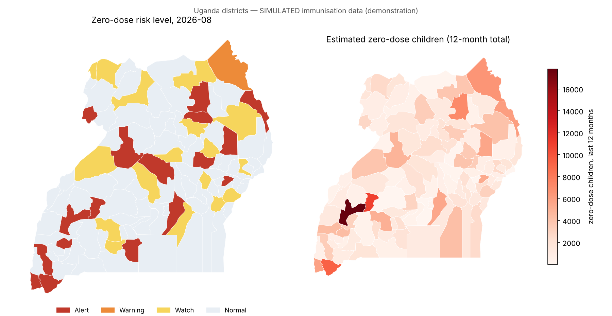
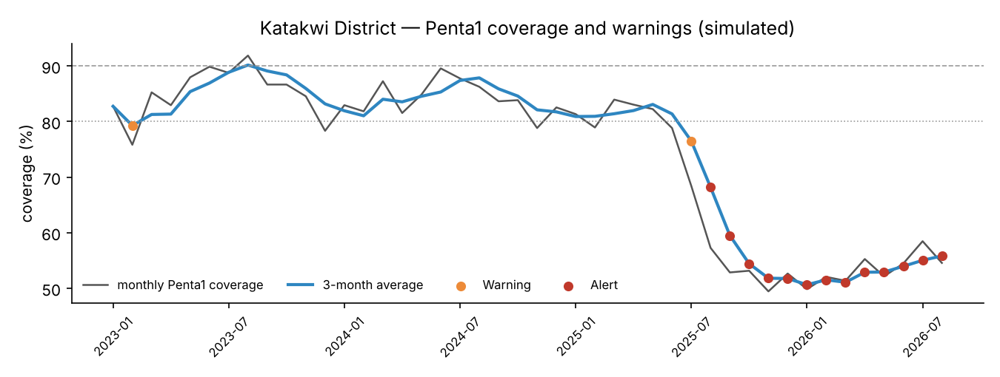

# zero-dose-early-warning

**An early-warning system that flags Ugandan districts where children are missing their first vaccine dose — and issues standards-compliant alerts.**

A *zero-dose* child has not received the first dose of DPT-containing vaccine (Penta1). Zero-dose children are the clearest signal of communities missed by routine immunisation, and a sudden rise usually means something has broken: a vaccine stock-out, insecurity, a strike or suspended outreach. This repository turns monthly district immunisation reports into an operational warning chain:

**monthly reports → indicators → threshold + change detection → warning level → CAP alerts → map / GeoJSON / PostGIS views**

> **Data notice.** District names and boundaries are real (112 districts, [Natural Earth](https://www.naturalearthdata.com/), public domain). **All immunisation figures are simulated** for demonstration; no Ministry of Health or patient data are included. CAP messages are marked `status=Exercise`.



## What it does

| Step | Detail | Code |
|---|---|---|
| Data | Monthly HMIS-style district reports: target population, Penta1, Penta3, MCV1 (44 months, 112 districts) | `zerodose/simulate.py` |
| Indicators | Penta1 coverage (monthly and 3-month), Penta1→Penta3 dropout, **zero-dose children over the last 12 months** | `zerodose/indicators.py` |
| Warning logic | **Threshold**: 3-month coverage < 90 / 80 / 70 % → WATCH / WARNING / ALERT. **Change detection**: one-sided CUSUM on the fall below each district's own 12-month baseline, so a normally strong district that suddenly drops is caught early | `zerodose/warning.py` |
| Alerts | **Common Alerting Protocol (CAP 1.2)** XML per district: urgency/severity/certainty mapped from the warning level, district polygon + geocode targeting, and a full **Alert → Update → Cancel** lifecycle using `<references>`; every message is validated | `zerodose/cap.py` |
| GIS outputs | GeoJSON for QGIS/GeoServer, maps, trend charts | `run_pipeline.py` |
| Database | PostGIS schema with spatial index, integrity checks and warning views ready to publish as WMS/WFS | `postgis/schema.sql` |

## Results (simulated data, August 2026)

- **17 of 17** injected disruptions were raised to WARNING or ALERT, typically **within one month** of onset.
- 18 CAP alerts issued, all passing validation, plus an example Update and Cancel.
- Warning-level districts include some with chronically low coverage (mainly in the north-east), not only new disruptions; the CUSUM signal separates the two.



## Quick start

```bash
pip install -r requirements.txt
python run_pipeline.py            # writes outputs/: maps, GeoJSON, CSVs, cap_alerts/*.xml
pytest -q                         # 4 tests: boundaries, data integrity, detection, CAP validity
```

Load into PostGIS:

```bash
psql -d ews -f postgis/schema.sql
ogr2ogr -f PostgreSQL PG:"dbname=ews" data/uganda_districts.geojson -nln admin.districts -lco GEOMETRY_NAME=geom
# then load outputs/immunisation_monthly_simulated.csv into health.immunisation_monthly
# health.v_zero_dose_warning can be published directly as a GeoServer WMS/WFS layer
```

The schema has been tested on PostgreSQL 16 with PostGIS 3.

## Using real data

Replace `simulate()` with an export from DHIS2 (HMIS 105 immunisation data elements: Penta1, Penta3, MCV1 doses and the under-1 target population) at district level and month period. The indicators, warning logic, CAP generation and PostGIS views work unchanged. Typical DHIS2 Web API call: `/api/analytics.csv?dimension=dx:<Penta1>;<Penta3>;<MCV1>&dimension=pe:LAST_12_MONTHS&dimension=ou:LEVEL-3`.

## Design notes

- **Warning authority stays with people.** The system *prepares* CAP messages; issuing them is for the designated approving authority. Messages are generated with `status=Exercise`.
- **Two signals, not one.** Fixed thresholds miss a fall from 98% to 85%; CUSUM catches it within weeks while staying quiet on normal noise.
- **Geographic targeting.** CAP polygons are simplified to ≤ 60 vertices, closed and in `lat,lon` order, as CAP 1.2 requires.

## License

MIT © Moses Kizito
